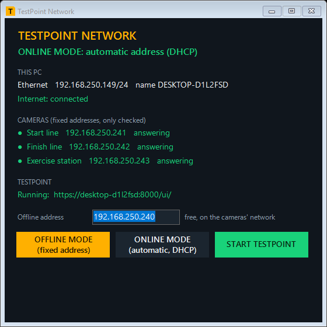

# Continue on another machine

Everything needed is on GitHub, except what is private to the station PC: the database
(`data/dev.db`: people, faces, results, the cameras' passwords), the HTTPS certificates and the
recordings in `data/`. Those are not in git on purpose.

## Where things are (2026-11-04)

| Branch / tag | What |
|---|---|
| `main`, tag `v1.0` | Shipped: daily face photos, start line camera (hand to start, start line timing, false start), finish by face, one-mat station, results, desktop icon |
| `feat/percentages` (PR #81) | **Latest work, not merged:** correct a saved result (PR #80), exact percentages per test and overall, the overall as a ring on the results card |
| `phase2/out-of-position` | Phase two, kept apart: leaving the exercise position ends the station test |

Work continues on `feat/percentages` (it contains everything in `main` too).

## 1. Get the code

```bash
git clone https://github.com/Boynet006/TestPoint.git
cd TestPoint
git checkout feat/percentages
```

## 2. Set it up (Windows, Python 3.12)

```powershell
py -3.12 -m venv .venv
.venv\Scripts\python.exe -m pip install -e ".[app,dev]"
.venv\Scripts\python.exe -m testpoint.api.faces --download data\models\face
winget install --id Gyan.FFmpeg -e        # browser-playable evidence clips (H.264)
```

GPU: install `onnxruntime-gpu` as the README says; without it everything runs on the CPU, slower.
The fonts are in the app (`web/station/fonts`): no internet needed once set up.

## 3. Run it

Once: `scripts\https-cert.ps1` (README, "HTTPS"), then put the icon on the desktop:

```powershell
powershell -ExecutionPolicy Bypass -File scripts\make-shortcut.ps1
```

The **TestPoint** icon starts the app and the camera service (logs in `data\logs`) and opens
Chrome; each screen starts its own camera. While developing, run them by hand instead (the app
then reloads on code changes):

```powershell
$env:DISABLE_SQLALCHEMY_CEXT_RUNTIME = "1"
.venv\Scripts\python.exe -m testpoint.api.app --host 0.0.0.0 --port 8000 --db sqlite:///data/dev.db --reload --https
.venv\Scripts\python.exe -m testpoint.camhost        # second window: the cameras
```

TestPoint opens by this PC's name (e.g. `https://desktop-d1l2fsd:8000/ui/`), never its address, so
a new address changes nothing. The certificate must carry the name: `scripts\https-cert.ps1` adds it.

## Offline and online: the TestPoint Network icon



- **Offline mode:** this PC gets a fixed address on the cameras' network (default
  192.168.250.240, checked free first): works with no router and no internet.
- **Online mode:** back to automatic (DHCP) for the internet.
- It shows this PC's address, the internet, each camera (answering or not) and TestPoint, and
  starts TestPoint. The cameras keep their fixed addresses (.241 start, .242 finish, .243 station);
  they are only checked. Windows asks for administrator permission when a mode button is pressed.
- Settings: `data\network.json` (the offline address, the camera list).

## 4. What to redo on the new machine

- **Cameras:** Settings > Cameras: type each camera's address with its password again.
- **Camera picture quality** (set in each camera, not in the app): main stream 2688x1520, 25 fps,
  H.264 High, constant bitrate 8192 kbps (their maximum). Set on all three on 2026-11-05.
- **Camera image** (2026-11-05): WDR **auto** on all three (on by itself against the sun outdoors,
  off in even light); day/night automatic; stream smoothing 30; a one-push focus on each once it
  is in its final place (refocus after moving a camera). Shutter 1/250 s at the start line and the
  station (people stand still or move slowly). The **finish** shutter follows the light by itself
  (Settings > Cameras > Finish camera shutter, Automatic; `src/testpoint/api/light.py`): it tries
  1/500 then 1/1000 s every 20 minutes and keeps it only when the picture stays as bright and clean,
  goes slower when the picture gets dark, and never tries while someone is running. Indoors here it
  stays at 1/250 s (1/500 s halved the brightness); outdoors in daylight it goes faster.
- **Fair finish times:** a crossing is timed at the instant the feet cross the line, interpolated
  between the two camera frames around it, from when those frames arrived from the camera, not when
  the analysis got to them (the GPU's load no longer changes anyone's time).
- **People:** the database starts empty; register candidates again (fresh face photos each day).
- **Lines:** the finish and start line positions are kept per browser: set them again on the
  finish and start line screens (Line set-up).

## 5. Tests

```powershell
$env:DISABLE_SQLALCHEMY_CEXT_RUNTIME = "1"; .venv\Scripts\python.exe -m pytest -q
```
